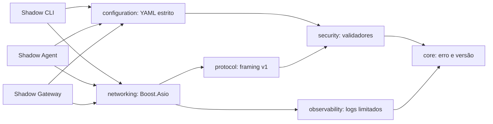
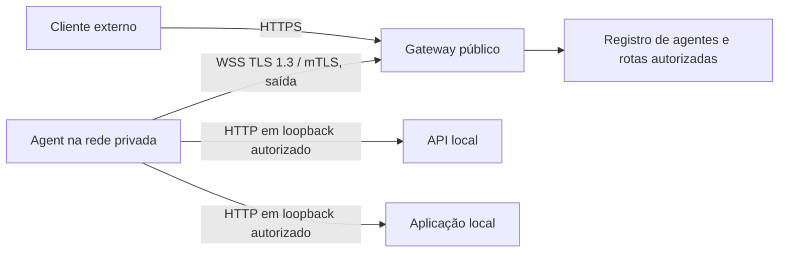
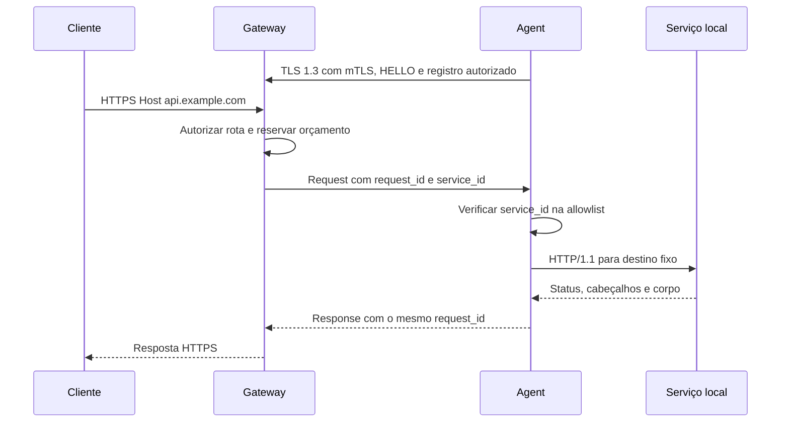

# Arquitetura

## Escopo implementado no M1

O transporte de diagnóstico usa TCP sobre um endereço literal de loopback.
Não faz resolução DNS e não tem caminho para encaminhar requisições externas.
Cada conexão contém apenas HELLO e HELLO_ACK, com memória e tempo limitados.

Cada executável utiliza um único `io_context`, executado em uma única thread.
Leituras, escritas, conexão e timers são assíncronos. Cada sessão possui seus
próprios buffers e estado; não há dados de payload globais. O Gateway limita
sessões ativas, além do backlog do sistema operacional. Sockets, timers e
buffers têm posse RAII; callbacks mantêm a sessão viva até a conclusão.
Cancelamento é idempotente e fecha sockets e timers. Uma falha de sessão
não derruba o listener; uma falha do listener encerra o processo com erro.

Os limites do protocolo precedem a alocação do corpo. O limite de conexões e o
deadline total do handshake limitam memória e retenção por clientes ociosos.
Isso é contenção inicial; não equivale ao controle de fluxo do proxy futuro.

## Decisões de dependências

| Dependência | Uso | Decisão |
|---|---|---|
| Boost.Asio | TCP e timers assíncronos | Portável; permite integrar Beast depois |
| yaml-cpp | Parsing YAML | Schema e autorização continuam no ShadowNet |
| Catch2 3 | Testes unitários | Integração com CMake/CTest, sem framework próprio |
| stdlib C++20 | RAII, erros, logging | Evita outra dependência para logs simples |
| Python 3 | Integração de processos/sockets e API de exemplo | Não é dependência do runtime C++ |
| Boost.Beast | HTTP/1.1 e WebSocket | Planejado para M2/M3, ainda não utilizado |
| OpenSSL 3 | TLS 1.3 e mTLS | Planejado para M2; sem criptografia própria |

O bootstrap fixa versões e hashes; o modo de pacotes instalados delega versões
ao operador. O build de produção futuro precisará de inventário/SBOM, política
de atualização e revisão de avisos de segurança. `core` permanece pequeno,
sem uma hierarquia genérica de sockets ou plugins sem consumidores concretos.

## Arquitetura alvo (ainda não implementada)

No M3, começar com mensagens HTTP completas limitadas e tabela de correlação
por sessão. Limitar requisições em voo antes de otimizar multiplexação.
Buffers sem limite, destinos fornecidos pelo cliente e confiança irrestrita em
`Host`, `Forwarded` ou `X-Forwarded-*` não são aceitáveis.
