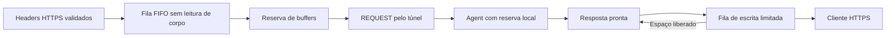

# Controle de recursos e recuperação — M4

O M4 mantém HTTP/1.1 por mensagens completas e o protocolo WSS v3. Não adiciona
streaming nem créditos na rede. Há uma única thread de execução Asio por
processo; orçamentos e filas pertencem a esse executor.

## Admissão antes de alocar corpos

`BufferBudget` concede reservas RAII compartilhadas, com contadores de uso e
pico. Uma reserva só volta ao orçamento quando o último proprietário é
destruído. Cancelar um socket não libera prematuramente os buffers que seus
handlers ainda usam. O orçamento do Agent persiste entre reconexões.

Seja `M = 1081356` bytes, o teto da mensagem v3 incluindo framing:

| Escopo | Reserva | Liberação |
|---|---:|---|
| HTTP público, todas as conexões do Gateway | `4*M = 4325424` por requisição admitida | Fim da conexão e dos handlers |
| HTTP local do Agent | `4*M` por trabalho | Fim do I/O e aceitação da resposta na fila WSS, ou CANCEL/desconexão |
| Sessões WSS do Gateway, incluindo handshakes | `8*M = 8650848` por sessão | Fim da sessão e dos handlers |

O default de 64 MiB admite até 15 reservas HTTP ao mesmo tempo; 128 MiB admite
15 reservas WSS. `max_connections` e `max_in_flight` continuam sendo tetos
independentes. O Agent tem um único túnel, com filas fixas, além do orçamento
de trabalhos HTTP locais. Reservas não pré-alocam esses bytes.

No listener público, TLS e headers limitados são lidos primeiro. Após validar
os headers, o cliente entra numa fila FIFO de referências fracas, limitada
pelas conexões vivas. Não se lê o corpo nem se envia 100-continue até obter
reserva. Isso propaga pressão ao TCP e evita acumular corpos de clientes
que ainda não podem ser atendidos. A espera consome o deadline original de
TLS/leitura; uma espera expirada fecha a conexão. Headers/body read-ahead têm
buffer fixo limitado; não há fila de corpos fora da admissão.

O Agent retorna 503 quando não consegue reservar trabalho local. No listener
WSS, falta de reserva fecha TCP antes de criar contexto de sessão/handshake.

## Backpressure e controle de fluxo

`Outbox` inclui a escrita ativa no limite de 4*M bytes e 56 mensagens de
dados. Há oito posições reservadas a HELLO/WELCOME/PING/PONG/GOODBYE, que têm
prioridade sobre dados ainda não iniciados. A escrita ativa é imutável até
seu callback terminar; mensagens não são intercaladas. CANCEL permanece na
fila de dados, atrás de REQUESTs anteriores. Uma mensagem de 1 MiB ainda pode
atrasar um heartbeat; os prazos continuam encerrando conexões sem progresso.

A capacidade é verificada antes de serializar uma mensagem rejeitada. O
buffer de escrita WebSocket passa de 512 B para 16 KiB, reduzindo fragmentos
e chamadas de I/O. A única escrita pendente do Beast é preservada.

O Agent serializa uma resposta pronta uma vez e mantém sua reserva enquanto
a fila WSS estiver cheia. O callback de drenagem tenta encaminhá-la de novo;
nenhuma requisição HTTP é repetida na origem. CANCEL remove uma resposta
ainda adiada. Trabalhos normais continuam limitados por slots/orçamento; há
um teto adicional de 128 registros incluindo pequenas rejeições para impedir
que um peer autenticado acumule respostas sem limite. Excedê-lo viola o
protocolo e encerra a sessão.

`write_timeout_ms` limita cada escrita WSS completa. Heartbeat, deadline
HTTP local, deadline do Gateway e encerramento limitado continuam ativos.
Fila cheia no Gateway devolve 503 para a nova requisição. CANCEL é best effort:
se não houver capacidade, o deadline local ainda limita o trabalho. CANCEL
não desfaz efeitos da aplicação. POST não é reenviado após reconexão.

## O que o orçamento mede

Trata-se de admissão conservadora de buffers das transações/túneis, com custo
fixo por mensagem máxima, inclusive para GETs pequenos. Não é um alocador
instrumentado nem um teto de RSS. OpenSSL, allocator, objetos de conexão,
headers pré-admissão, socket buffers do kernel e custos de dependências têm
overhead adicional. Reservas de escopos diferentes não devem ser somadas como
se fossem memória residente medida. Dimensionar também RAM, limites do SO,
timeouts e limites de conexões; cargas locais não garantem capacidade de WAN.

Limites e garantias são testados por saturação, clientes/túneis lentos, perda
de processos e tráfego concorrente. Resultados: [M4](../milestones/m4.md).
