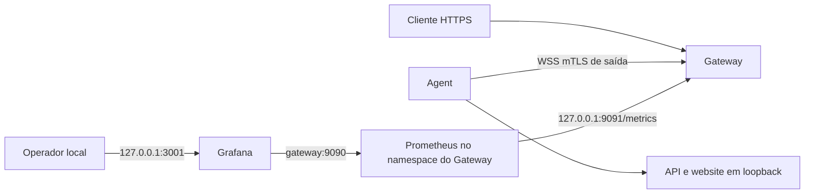

# Observabilidade — M6

Versão 0.6.0; protocolo do túnel v3. Agent e Gateway mantêm métricas por
processo. Sem nova biblioteca C++: registro tipado, snapshots sob mutex,
relógio monotônico e observações HTTP RAII em `libs/observability`.
Beast/Asio atendem a coleta local assíncrona.

## Habilitar e coletar

Acrescentar ao YAML WSS (seção raiz, portas distintas nos dois processos):

```yaml
metrics:
  bind_host: 127.0.0.1
  port: 9091
  max_connections: 4
  timeout_ms: 2000
```

Sem `metrics`, nenhum socket adicional é aberto. Agent pode usar 9092. Somente
IP literal `127.0.0.1`/`::1`; porta não pode coincidir com listeners públicos
do Gateway ou destinos dos serviços publicados pelo próprio Agent. A seção
é rejeitada no diagnóstico `local_tcp`. Validar com `shadow config validate`
antes de iniciar; validação não reserva a porta.

`GET /metrics` e `HEAD /metrics` usam HTTP/1.1 local, formato Prometheus
`text/plain; version=0.0.4; charset=utf-8`. Host precisa ser `localhost`,
`127.0.0.1` ou `[::1]`, opcionalmente com a porta exata. Origin, corpo,
transfer-encoding, métodos e paths diferentes são rejeitados. Sem query string,
keep-alive, CORS ou autenticação nesse listener. Um scrape não entra nas
métricas de requisições da aplicação. `/metrics` na porta HTTPS pública continua
sendo um path da aplicação, submetido à política normal de serviço.

Header até 4096 B, buffer 8192 B, resposta até 256 KiB e limite de 1–16
conexões (default 4). O prazo de 100–10000 ms (default 2000) cobre leitura e
escrita juntas. Uma conexão excedente é fechada. O event loop é compartilhado
com o tráfego do processo; um operador local pode consumir a coleta, mesmo
com os limites. Falha de bind/listener é erro de runtime, sem fallback público.

Exemplo de job Prometheus instalado no mesmo host/namespace do Gateway:

```yaml
scrape_configs:
  - job_name: shadownet-gateway
    scrape_interval: 5s
    scrape_timeout: 2s
    sample_limit: 2048
    label_limit: 8
    body_size_limit: 256KB
    static_configs:
      - targets: ['127.0.0.1:9091']
```

O Agent requer coletor no seu próprio host/namespace ou acesso administrativo
autorizado. Não existe exportação automática das métricas do Agent pelo túnel.
Não publicar esse endpoint como serviço. Outros processos locais podem ler
nomes configurados e estado; loopback não é autenticação contra adversário local.
O IP de origem continua visível ao Gateway, roteador/ISP e administradores.

## Semântica e unidades

Todos os nomes abaixo têm prefixo `shadownet_`. Counters reiniciam com o
processo; reconexão do túnel mantém os counters do Agent. Usar `rate`/`increase`
para tratar resets. Gauges mostram o estado no instante da coleta.

| Métrica | Significado |
|---|---|
| `build_info{version,role}` | Valor 1, versão e papel gateway/agent |
| `uptime_seconds` | Tempo monotônico desde a criação do registro |
| `http_requests_total`, `http_in_flight` | Trocas HTTP iniciadas e ainda pendentes |
| `http_completed_total`, `http_aborted_total` | Concluídas e abandonadas; em voo = iniciadas − concluídas − abandonadas |
| `http_responses_total{status_class}` | Respostas concluídas, classes fixas 2xx/3xx/4xx/5xx |
| `http_request_duration_seconds` | Histograma até conclusão/abandono; inclui espera por orçamento e origem |
| `http_request_body_bytes_total` | Corpos de requisição recebidos integralmente, somados no encerramento da troca |
| `http_response_body_bytes_total` | Corpos de respostas concluídas; HEAD/204/304 não contam representação omitida |
| `https_connections_total`, `https_connections_active` | Conexões públicas admitidas, incluindo TLS/leitura/shutdown; apenas Gateway |
| `tunnel_connections_total`, `tunnel_connections_active` | Tentativas admitidas de túnel, incluindo handshake |
| `tunnels_active` | Sessões WSS autenticadas, ainda sem exigir registro de serviço |
| `routes_active` | Hostnames autorizados registrados; apenas Gateway |
| `agent_up{agent}` | Identidades da configuração autenticadas; não é health check do backend |
| `tunnel_bytes_total{direction}`, `tunnel_messages_total{direction}` | Mensagens WSS concluídas, directions sent/received; bytes de payload com header v3, controle e heartbeat |
| `tunnel_closures_total{reason}` | Categorias fixas closed/authentication/protocol/heartbeat/credentials/write/other |
| `buffer_used_bytes`, `buffer_peak_bytes`, `buffer_capacity_bytes` | Reservas de admissão, scopes http/tunnel; **não são RSS** |
| `events_total{event}` | connection_limit/buffer_limit/backpressure/reconnect/in_flight_limit |
| `metrics_scrapes_total` | GET/HEAD válidos aceitos pelo exporter, inclusive se a escrita depois falhar |
| `log_events_suppressed_total` | Supressões acumuladas pelo limitador de logs do processo |

No Gateway, observação HTTP começa após headers ou ao detectar erro de parsing;
termina quando a escrita da resposta completa, antes do shutdown TLS, ou quando
a conexão abandona a troca. TLS handshake e upload ainda sem headers completos
não entram em RPS/latência, mas entram nas conexões. Erros com resposta HTTP
(inclusive 4xx/5xx) são conclusões; falha antes de completar a escrita é abandono.

No Agent, observação começa após decodificar uma requisição válida do túnel;
termina ao aceitar a resposta na fila WSS ou ao cancelar/encerrar. Inclui espera
sob backpressure e rejeições da política local. Esse ponto não prova entrega
ao Gateway ou leitura pelo cliente. Não somar Gateway e Agent como se fossem
requisições distintas: a mesma troca é medida em etapas diferentes.

Histogramas têm buckets cumulativos em segundos: 0.005, 0.01, 0.025, 0.05,
0.1, 0.25, 0.5, 1, 2.5, 5, 10, +Inf; `_sum` e `_count`. +Inf = count =
conclusões + abandonos. Percentis são estimativas por buckets, não amostras
exatas. Bytes não incluem headers HTTP, overhead WebSocket/TLS/IP ou tráfego
parcial que falhou. Throughput é de payload medido, não consumo da interface.

Reservas incluem granularidade conservadora de mensagem máxima; custos TLS,
kernel e allocators estão fora. Scope tunnel é aplicável ao orçamento global
do Gateway; no Agent fica zero, sem representar sua outbox como memória livre.
Eventos são ocorrências de controle, não contagens universais de usuários
rejeitados. `backpressure` conta transições para espera no Agent;
`reconnect` conta agendamentos de retry. Requisições 429/502/503/504 podem ser
acompanhadas como classes HTTP, sem label de status individual.

Labels fixas e até 1024 nomes de agentes da configuração (até 64 caracteres)
limitam cardinalidade. Paths, queries, hosts de serviços, IPs, fingerprints,
IDs, corpos e headers não viram labels. `agent_up` inclui identidades offline;
um peer desconhecido/duplicado não cria série nem derruba o estado do legítimo.
Sem tracing, métricas por visitante/serviço ou auditoria persistente.

## Consultas PromQL

RPS concluído no Gateway (usar iniciadas para taxa de admissão):

```promql
sum(rate(shadownet_http_completed_total{job="shadownet-gateway"}[5m]))
```

Latência p95 em segundos, incluindo abandonos:

```promql
histogram_quantile(0.95, sum by (le) (rate(shadownet_http_request_duration_seconds_bucket{job="shadownet-gateway"}[5m])))
```

Tráfego WSS por sentido, bytes/s, e erros de resposta por classe:

```promql
sum by (direction) (rate(shadownet_tunnel_bytes_total{job="shadownet-gateway"}[5m]))
sum by (status_class) (rate(shadownet_http_responses_total{job="shadownet-gateway"}[5m]))
```

Inspecionar `up{job="shadownet-gateway"}` antes de concluir que um agente está
offline: falha de scrape não é gauge zero. Para operação, avaliar alertas sobre
`up == 0`, `agent_up == 0`, taxa 5xx/abandonos e reservas próximas da capacidade.
Não há regras/Alertmanager pré-configurados nem promessa de SLA neste milestone.

## Laboratório Docker com Grafana

Overlay opcional: Prometheus 3.16.0/Grafana 13.3.1 fixados por digest, externos
ao runtime C++. Gerar **novo** diretório de PKI; o script recusa sobrescrita e
cria certificados de dois dias, YAML com exporters e segredo Grafana aleatório
com permissões restritas. Não usar a CA de teste em produção ou instalá-la no SO.
O segredo é gravado sem CRLF, para consistência entre shell Docker e Windows.

```powershell
python scripts/dev-certificates.py --output build/dev-pki-m6 --metrics
$env:SHADOW_PKI_DIR='../build/dev-pki-m6'
docker compose -p shadownet-m6 -f docker/compose.yaml -f docker/monitoring.yaml up --build -d
python scripts/check-demo.py --ca-file build/dev-pki-m6/ca.crt
python scripts/check-monitoring.py --password-file build/dev-pki-m6/grafana-admin-password
```

No Unix substituir a atribuição PowerShell por
`export SHADOW_PKI_DIR=../build/dev-pki-m6`. UID/GID default 1000; se necessário
definir explicitamente `SHADOW_UID`/`SHADOW_GID` para ler mounts protegidos.
Docker Desktop pode exigir acesso autorizado ao daemon. Não relaxar ACL/chaves.



Grafana: `http://127.0.0.1:3001`, usuário `admin`, senha no arquivo gerado
`build/dev-pki-m6/grafana-admin-password`; ler privadamente, sem copiar para
comandos, logs ou Git. O Compose entrega via Docker secret e configuração
`__FILE`, sem senha padrão no repositório. Login anônimo/cadastro desabilitados.
Dashboard provisionado `ShadowNet / ShadowNet — Gateway`, UID
`shadownet-overview`: oito painéis para túneis, rotas, agentes, RPS, p95,
throughput, classes HTTP e reservas. Datasource UID `shadownet-prometheus`.
RPS precisa de pelo menos dois scrapes; p95 pode ficar vazio/NaN sem tráfego.

Prometheus: `http://127.0.0.1:9090`, sem autenticação, publicado apenas no
loopback do host. Não há publicação da porta exporter 9091. O sidecar
compartilha o namespace do Gateway para coletar loopback; o Agent está em outro
namespace e **não é coletado por esse overlay**. O painel de agentes usa o
estado das identidades conhecido pelo Gateway, não o registro interno do Agent.

Prometheus/Grafana usam rootfs somente leitura, cap_drop e no-new-privileges,
limites de CPU/memória e dados em tmpfs. Retenção Prometheus 1 h, tmpfs 128 MiB,
memória 256 MiB; Grafana dados 128 MiB/memória 512 MiB. Sem volume durável,
backup ou garantia de que toda a hora caiba na memória. Reinício perde histórico
e alterações locais; painel/datasource são recriados pelos arquivos versionados.

Ao reiniciar Gateway, reiniciar o coletor em seguida para reanexar o namespace:

```powershell
docker compose -p shadownet-m6 -f docker/compose.yaml -f docker/monitoring.yaml restart gateway
docker compose -p shadownet-m6 -f docker/compose.yaml -f docker/monitoring.yaml restart prometheus
python scripts/check-demo.py --ca-file build/dev-pki-m6/ca.crt
python scripts/check-monitoring.py --password-file build/dev-pki-m6/grafana-admin-password
docker compose -p shadownet-m6 -f docker/compose.yaml -f docker/monitoring.yaml down
```

O checker confirma scrape real após 16 requisições do demo, dashboard com oito
painéis, datasource saudável e rejeição de leitura anônima. Ele não simula
renderização de navegador. Para produção, instalar/configurar monitoramento
próprio, com retenção, backup, atualização e acesso administrativo apropriados.
O overlay é ambiente local reproduzível; não faz deploy em uma VPS.

## Referências e validação

Formato conforme [exposição Prometheus](https://prometheus.io/docs/instrumenting/exposition_formats/)
e [convenções de nomes/unidades](https://prometheus.io/docs/practices/naming/).
O uso de `__FILE` segue [configuração Docker Grafana](https://grafana.com/docs/grafana/latest/setup-grafana/configure-docker/).
Resultados efetivamente executados: [relatório M6](milestones/m6.md).
