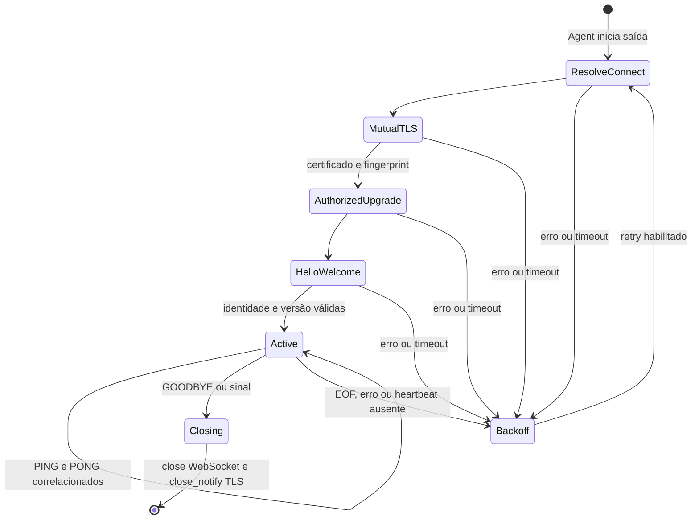

# Túnel WSS v2 — M2

Documento histórico do M2. O runtime atual usa [v3](proxy-v3.md) e exige
atualizar Agent e Gateway juntos; o gerador atual também cria configurações
de publicação M3. Os limites de frames/fila e tipos adicionais estão no v3.

Transporte: TCP → TLS 1.3 com mTLS → WebSocket HTTP/1.1, somente no caminho
`/shadow/tunnel/v2`, com subprotocolo obrigatório `shadownet.v2`.
O Gateway rejeita `Origin` de navegador e não oferece outra rota HTTP pública.
O upgrade é limitado a 8 KiB de headers e não aceita corpo. Não há compressão.

Antes do upgrade, verificar cadeia X.509 estrita, validade e propósito do
certificado cliente, e associar o SHA-256 do certificado DER completo a uma
identidade autorizada. O nome enviado em HELLO precisa corresponder à identidade.
Uma segunda sessão da mesma identidade é rejeitada, preservando a primeira.

## Envelope

Uma mensagem WebSocket **binária** contém exatamente um envelope, até 268 bytes.
O Beast acumula fragmentos dentro desse limite; mensagens de texto são rejeitadas.

| Offset | Bytes | Campo |
|---|---|---|
| 0 | 4 | ASCII `SHDW` |
| 4 | 1 | Versão `2` |
| 5 | 1 | Tipo |
| 6 | 2 | Reservados, zero |
| 8 | 4 | Comprimento do payload, big endian, 1–256 |
| 12 | N | Payload ASCII, sem terminador |

| Tipo | Direção | Payload e significado |
|---|---|---|
| 1 HELLO | Agent → Gateway | Nome de 1–64 caracteres em `a-z0-9_-`; conferido contra o certificado |
| 2 WELCOME | Gateway → Agent | `session_id:interval_ms:timeout_ms`; ID aleatório de 128 bits em 32 hex minúsculos; tempos 100–60000 ms |
| 3 PING | Agent → Gateway | Contador uint64 em 16 hex minúsculos; começa em 1 e incrementa |
| 4 PONG | Gateway → Agent | Exatamente o contador do PING recebido |
| 5 GOODBYE | Ambos | Literal `shutdown`, seguido de fechamento WebSocket normal |

Esses PING/PONG são mensagens de aplicação, independentes dos control frames
WebSocket. O Agent mantém no máximo um PING pendente; respostas fora de ordem,
duplicadas ou não solicitadas encerram a sessão. O Gateway exige contadores
consecutivos. O contador nunca é reutilizado dentro da sessão nem sofre wrap.

TLS fornece integridade e proteção contra replay entre conexões. Sessões TLS
não são retomadas e 0-RTT está desabilitado. O ID de sessão vem de `RAND_bytes`
do OpenSSL; ele não concede autorização e não é credencial. Novas conexões
reiniciam estado e contadores. Nenhum pedido HTTP é repetido automaticamente.

## Estados, prazos e memória

Um deadline total inclui DNS, conexão, TLS, upgrade e HELLO/WELCOME. Receber
bytes parciais não reinicia o prazo. O Gateway espera um PING em
`interval_ms + timeout_ms`; o Agent espera o PONG em `timeout_ms` e agenda o
próximo PING após `interval_ms`. Esses valores são negociados pelo Gateway.

Cada sessão tem buffers próprios e fila de até quatro mensagens, com uma única
escrita ativa. Exceder a fila encerra a conexão; ainda não é o controle de fluxo
de corpos HTTP do M4. O limite de conexões inclui handshakes não autenticados.
Os handlers executam em um único `io_context`/thread por processo.

Fechamento voluntário envia GOODBYE, drena a fila e usa `async_close`. O teardown
SSL do Beast troca `close_notify` e fecha TCP. Um timer de 1 s impede bloqueio;
falhas de segurança/protocolo e deadlines fecham o socket imediatamente. Erros
são registrados como eventos fixos, sem refletir payload/credenciais ao peer.

O backoff usa jitter entre metade e o teto corrente: teto inicial configurado,
dobrado até `max_ms`. Somente uma sessão ativa por 30 s reinicia o teto. Falhas
de autorização também respeitam o backoff. Credenciais locais inválidas impedem
o startup. `reconnect.enabled: false` faz uma falha retornar 1; a sessão continua
persistente enquanto saudável. Shutdown solicitado ao Agent retorna 0.

## Próxima versão funcional

Registro de serviços, REQUEST/RESPONSE, IDs de requisição, roteamento e HTTP
entram no M3. Não existem frames fictícios para essas funções no M2. O protocolo
local v1 permanece disponível somente por configuração explícita e loopback;
nenhum erro de WSS causa fallback para TCP em texto claro.
